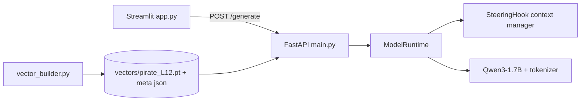

# MindShift: Activation Steering Lab - Plan

## Environment and workflow (updated)
- Workspace is empty (only `.git`, `LICENSE`). I will create `mindshift/` as a subfolder per your layout.
- Dev machine (this one): Windows, Python 3.13.7, no NVIDIA GPU. Used to write code, run the fast pytest suite, and run real smoke tests on a small HF model on CPU.
- Demo machine: Windows laptop with an RTX 4060 (8 GB). Use Python 3.11/3.12 and the CUDA build of PyTorch (e.g. `pip install torch --index-url https://download.pytorch.org/whl/cu124`). Qwen3-1.7B in bf16 (~4 GB) fits. Run backend and Streamlit there (no SSH required); `git pull` to sync.
- Ollama is NOT used: GGUF/llama.cpp exposes no hidden states or module hooks. Models come from Hugging Face via `transformers`.
- Configurable `MODEL_ID`: `Qwen/Qwen2.5-0.5B-Instruct` (~1 GB, closest family to Qwen3, CPU-friendly) for local smoke tests; `Qwen/Qwen3-1.7B` for the final demo. The runtime passes `enable_thinking=False` only when the chat template supports it.
- Test tiers: (1) tiny random-config model, no download, for hook logic; (2) Qwen2.5-0.5B on this machine for end-to-end; (3) Qwen3-1.7B on the 4060 for evaluation and demo.
- Add `scripts/smoke_test.py` printing clear pass/fail per phase so results can be pasted back from the laptop.
- Dtype: float32 on CPU, bfloat16 on CUDA (float16 fallback).

## Architecture

## Files (under `mindshift/`)
- `backend/schemas.py`: Pydantic `GenerateRequest/Response`, `HealthResponse`, `ConceptInfo`.
- `backend/model_runtime.py`: `ModelRuntime` loaded once (FastAPI lifespan). Picks device, model ID from env `MODEL_ID` (default `Qwen/Qwen3-1.7B`). `generate(prompt, max_new_tokens, seed, steering=None)` uses `apply_chat_template(..., enable_thinking=False)`, greedy by default (`do_sample=False`) and seeded sampling optional, with a `threading.Lock` so inference is sequential. Also exposes `get_layers()` (`model.model.layers`) and `encode_chat()`.
- `backend/steering.py`: `SteeringHook` context manager.
  - Hook on `layers[L]` output; handles tensor and tuple outputs (replace element 0, preserve rest).
  - Validates vector is 1-D with length `hidden_size`, finite, layer in range.
  - Casts vector to hidden's dtype/device; computes `hidden + alpha * vec`.
  - Applies to all positions every forward pass (prefill and each KV-cached decode step), so steering is consistent during autoregression.
  - Handles removal in `__exit__`/`finally`; assert no hooks remain after generation. `alpha == 0` short-circuits to return the output unchanged (guarantees baseline equality).
- `backend/vector_builder.py`: Run paired prompts through the model with `output_hidden_states=True`, take the chosen layer, mean-pool the last token (default) or mean over tokens, `vector = mean(pos) - mean(neg)`. Saves `.pt`/`.npy` plus a JSON sidecar (model_id, layer, shape, method, pooling, n_pairs, norm, timestamp). Includes the hidden-state indexing note: `hidden_states[L+1]` is the output of decoder layer L, which matches the hook point.
- `backend/main.py`: FastAPI with lifespan load, `GET /health` (model, device, loaded vectors), `GET /concepts`, `POST /generate`. Runs baseline then steered sequentially with the same seed/decoding settings, returns `latency_ms`. Returns 400 on unknown concept/layer, 404 if vector for that layer is missing, and 500 with logged traceback. Uses `logging`.
- `scripts/build_vectors.py`: CLI (`--layer`, `--layers 8,12,16`, `--concept pirate`) containing ~12-16 paired contrastive prompts (same content, pirate vs plain phrasing). Writes `mindshift/vectors/`.
- `frontend/app.py`: Streamlit: text area, concept selector (from `/concepts`), strength slider (0-8), layer input, Generate button, two columns baseline/steered, layer and latency metrics, short explainer expander. Backend URL from env `BACKEND_URL`.
- `tests/test_steering.py`: Uses a tiny randomly-initialized Qwen2/Llama config (no download) for fast tests: alpha=0 equals baseline logits and generation, alpha>0 changes hidden states by exactly `alpha*v`, shape/dtype/device preserved, tuple vs tensor output handling, hooks removed (including after exceptions), invalid shapes raise.
- `scripts/evaluate.py` (Phase 6): three fixed prompts, fixed seed, identical decoding; reports alpha=0 equality, hidden-state delta norm, outputs across alphas (e.g. 0, 2, 4, 8), and writes `eval_results.md` with a fluency-harm log (manual note plus simple heuristics: repetition ratio, non-ASCII ratio).
- `requirements.txt` (torch, transformers, accelerate omitted unless needed, fastapi, uvicorn, pydantic, numpy, streamlit, requests, pytest, httpx), `.env.example` (`MODEL_ID`, `DEVICE`, `BACKEND_URL`, `DEFAULT_LAYER`, `MAX_NEW_TOKENS`), `README.md` (setup, run, explanation, evaluation results, limitations).

## Execution order (smoke test after each phase)
1. **Phase 1**: scaffold, venv, install deps, `model_runtime.py`; smoke test: load Qwen3-1.7B and generate a readable baseline answer to "Explain gravity" (greedy, seed set).
2. **Phase 2**: `steering.py` + `tests/test_steering.py`; run pytest on the tiny model, then a real-model check that alpha=0 matches baseline and a random vector with alpha>0 changes hidden states and output.
3. **Phase 3**: `vector_builder.py` and `build_vectors.py`; build pirate vector at layer 12 (also sweep a couple of layers to pick a good default); check norm and that steering visibly shifts toward pirate style.
4. **Phase 4**: FastAPI endpoints; smoke test with `curl`/`httpx` against a running server.
5. **Phase 5**: minimal Streamlit UI; smoke test.
6. **Phase 6**: evaluation script and README results.

## Key design decisions and caveats
- Alpha scale: raw mean-difference vectors have an arbitrary norm. Strength is applied as `alpha * vector` exactly as specified. I will report the vector norm and the typical hidden norm at that layer so the slider range (likely 0-8, possibly vectors unit-normalized and scaled by mean hidden norm) is sensible. Decision to confirm below.
- Qwen3 layer count is 28, so layer 12 is mid-depth; the layer sweep will validate it.
- Generation is greedy for deterministic comparison; the seed is still set for any sampling mode. Baseline and steered runs share identical kwargs.
- Not done: fine-tuning, concurrent inference, extra concepts, polished UI.

## Decisions made
- Vector normalization: ON by default. Save the raw mean-difference vector plus metadata (raw norm, mean last-token hidden norm at that layer). At load time, steering vector = unit(raw) * mean_hidden_norm, so alpha is relative to typical activation magnitude (useful slider range roughly 0-1.5). A `normalize` flag allows raw behavior. The formula stays `hidden + alpha * steering_vector`.
- Hardware: develop here, test and demo on the 4060 laptop; no Ollama.

## Previously open decisions (superseded by the above)
- Keep raw (unnormalized) vectors as specified, or normalize to unit norm and scale by the layer's average hidden norm so slider values are comparable across layers? My recommendation: store the raw vector as specified, and add an optional normalized mode.
- Since there is no GPU, are you okay with CPU generation at ~64 tokens per request (tens of seconds per baseline+steered pair), or do you have a GPU machine or Colab to run the backend on?